# [FREE] [MAP] Alamo Shores Estates

Welcome to Alamo Shores Estates.

Eighteen trailers, a questionable amount of lawn, and a secret tunnel, sitting in Sandy Shores by the water.

## Features
- 18 furnished trailers, lived in, not dirty
- Gated entrance with a gatehouse and monument sign
- Yards, driveways, bins, and a little rec area
- Creek with a footbridge
- Secret tunnel (see below)
- Keeps random NPCs from wandering around the park

## Secret Tunnel
One of the trailers has a closet that isn't just a closet. Walk up to it in the bedroom, press **E**, and the door slides open. Take the stairs down, follow the hallway, and you'll come out of a drain under the bridge by the riverbed. Press **E** at the door there to get out, or to get back in.
Doors are synced, so if your buddy leaves the closet open, everyone knows.

```
/tp 21.43, 3669.07, 40.50     (the trailer)
/tp -146.93, 3647.24, 39.50   (the drain)
```

## Preview
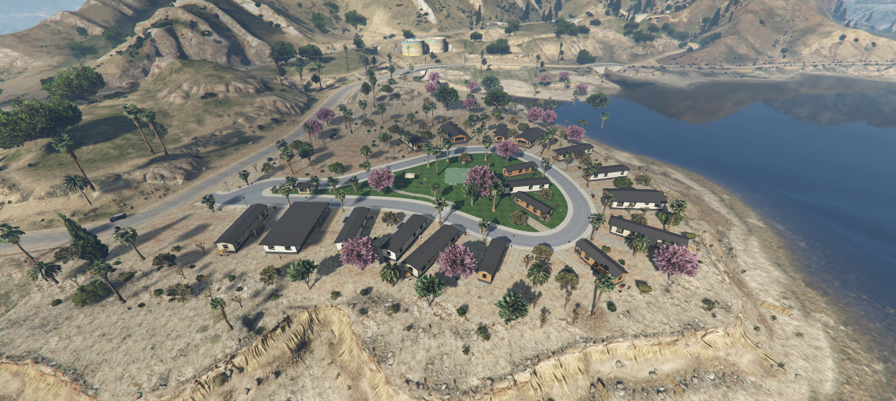
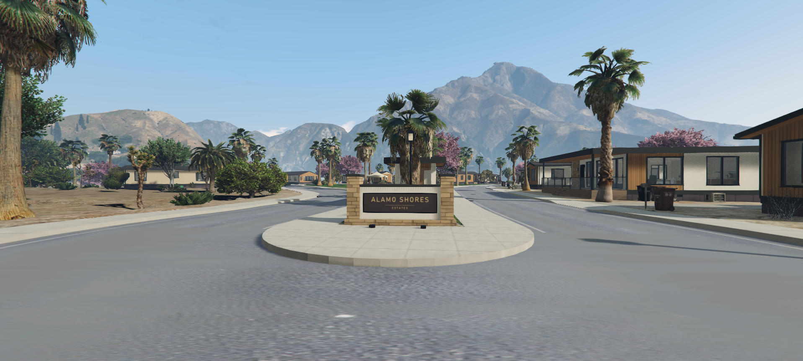
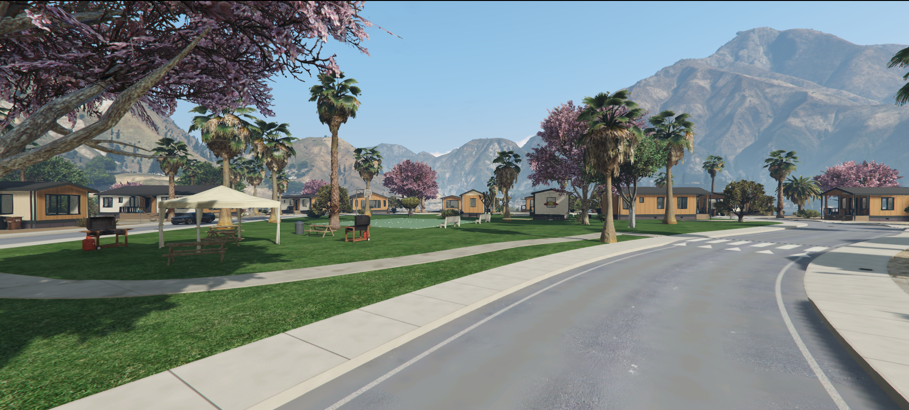
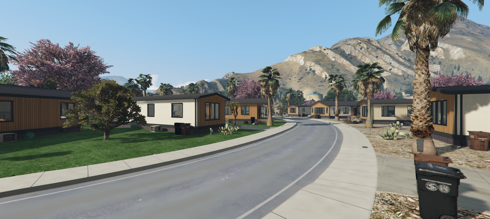
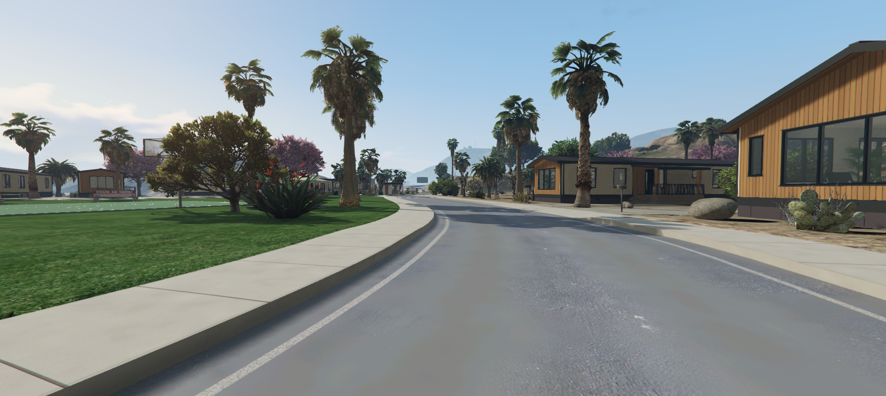
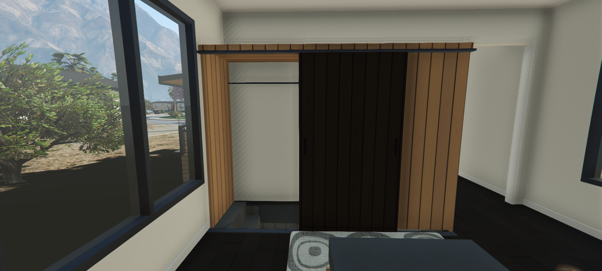
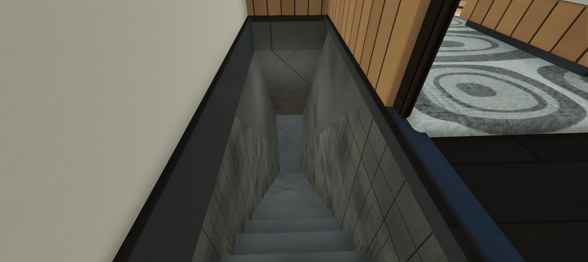
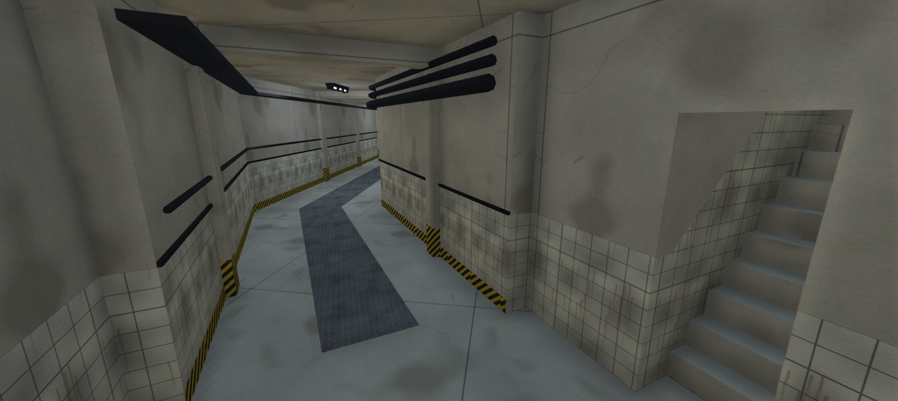
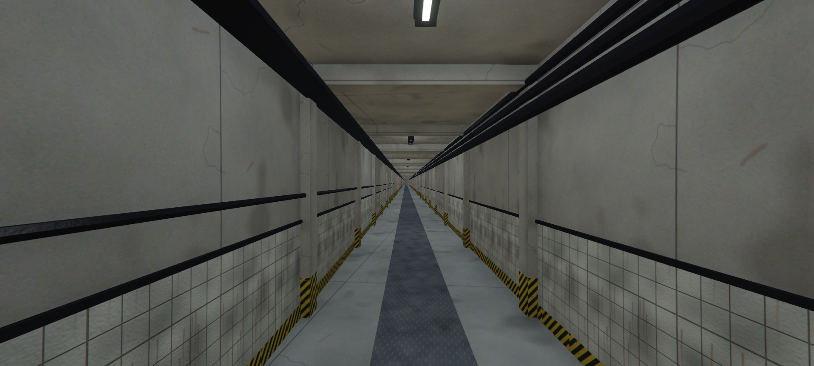
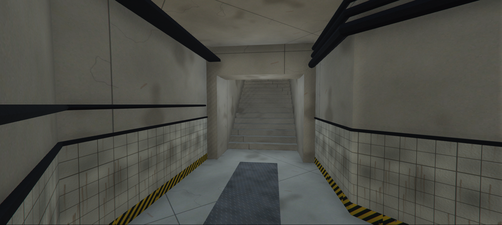
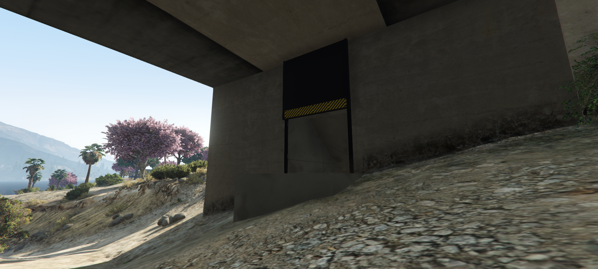

## Download
**GitHub:** https://github.com/OlentrixAssets/alamo_shores_estates

## Installation
It's literally like every other FiveM map resource. Drop it into your standalone resources folder, add `ensure olentrix_alamo_shores_estates` to your server.cfg, and restart your server.

Congratulations, you now own eighteen trailers and a questionable amount of lawn.

## Textures
All textures are conveniently packed into YTD files, making them easy to modify, customize, or completely ruin with your own questionable decisions.

## Heads up
This map replaces parts of Sandy Shores. If you're running another map in that same spot, they're going to fight, and nobody wins.
Depending on the map, we can make a compatibility version, but only if you provide the original files that are conflicting. No files, no fix.

```
/tp 73.40, 3612.00, 40.10
```

Remember, wipe your feet, don't park on the lawn, and for the love of everything holy, stop asking why your map isn't working when you forgot to ensure the resource.

Good day, you magnificent deviants.

---

| | |
|-|-|
| Code is accessible | Yes |
| Subscription-based | No |
| Lines (approximately) | 130 |
| Requirements | None, standalone |
| Support | Yes |

**Made with:** Blender 5.2.3 · Sollumz 2.9.0 · CodeWalker (Latest Release) · DirectXTex texconv 2026.5.8.1 · OpenIV 4.1
